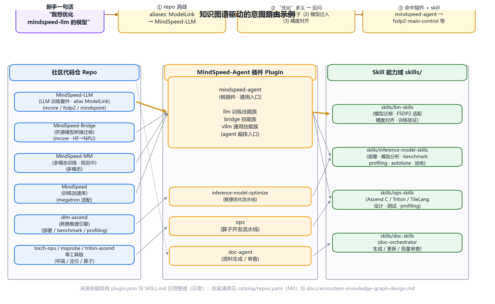

# MindSpeed-Agent


[](https://agentskills.io)


📖 [架构设计](#-项目架构) · [贡献指南](CONTRIBUTING.md) · [开发规范](CLAUDE.md)

---

## 📢 项目概述

**MindSpeed-Agent** 是面向 MindSpeed 大模型开发套件的智能体，提供覆盖 **模型迁移调优**、**算子开发优化**、**推理部署** 等场景的 Agent Skills 集合。

**面向用户**：MindSpeed / Ascend NPU 平台的大模型开发者（训练、推理、模型迁移、算子调优等），同时欢迎社区开发者共建 Skills 和 Agents。

## 🚀 快速开始

### 前置条件

- 安装 [Claude Code](https://code.claude.com/docs/en/setup)、[Codex](https://code.claude.com/docs/en/setup) 或 DSH（`npm install -g @deepseek-ai/dsh`）之一

### 安装（core + 领域按需安装）

仓库采用 **core + 领域 unit 按需安装**架构（[设计文档](docs/install-on-demand-design.md)）：
默认只安装 **core**（`ecosystem-routing` 意图路由 + catalog 知识图谱底座，不随装
40 个领域技能）；用户诉求被路由命中某个领域后，再按需安装对应插件并新开会话。

```bash
git clone https://github.com/Ascend/MindSpeed-Agent.git
cd MindSpeed-Agent
```

**Windows**（CMD）：

```cmd
install.bat                     REM Claude Code + core（默认）
install.bat dsh                 REM DSH + core
install.bat codex               REM Codex + core
install.bat all                 REM 全部平台 + core
install.bat claude-code all     REM Claude Code + 全部领域 unit（历史全量行为）
install.bat dsh mindspeed-llm   REM DSH + core + mindspeed-llm 领域 unit
```

**Linux / macOS**：

```bash
bash install.sh                 # Claude Code + core（默认）
bash install.sh dsh             # DSH + core
bash install.sh codex           # Codex + core
bash install.sh all             # 全部平台 + core
bash install.sh claude-code all # Claude Code + 全部领域 unit
bash install.sh dsh mindspeed-llm  # DSH + core + mindspeed-llm
```

**领域 unit 一览**（core 之外均按需安装）：

| unit | 覆盖能力 | 技能数 |
| --- | --- | --- |
| `mindspeed-llm` | LLM 训练：迁移/FSDP2/精度/训练验证 | 16 |
| `inference-model-optimize` | vLLM 昇腾推理部署/寻优/基准/剖析 | 12 |
| `ops` | 算子设计→实现→优化 | 5 |
| `doc-agent` | 资料生成/四维审查 | 5 |

查看安装状态 / 按需安装：

```bash
python tools/install-unit.py status          # 各 unit 是否已装
python tools/install-unit.py dsh mindspeed-llm        # DSH 投影该 unit
python tools/install-unit.py claude mindspeed-llm     # 打印 Claude 安装命令（--run 执行）
python tools/install-unit.py codex mindspeed-llm      # 打印 Codex 安装命令（--run 执行）
```

> ⚠️ Claude Code / Codex / DSH 安装新 unit 后均需**新开会话**方可加载其 skills。

### 安装后使用

启动 Claude Code / Codex / DSH，直接用自然语言描述需求。core 的
`ecosystem-routing` 会先把话术路由到正确代码仓与领域插件；若目标 unit 尚未
安装，会给出按需安装命令（见上）：

```text
"我想优化 mindspeed-llm 的模型"
"检查当前 CANN 环境配置"
"把这个模型从 GPU 迁移到 NPU 上跑"
```

也可显式调用：`/mindspeed-agent:<skill-name>`

> MindSpeed-Agent 同时支持 Claude Code / Codex / DSH 三个平台，共享同一套
> Skills、状态机与 catalog 图谱。安装时通过脚本参数选择平台与安装单元
> （见上方安装命令与 [v2 安装设计](docs/install-on-demand-design.md)）。

#### 推理优化流水线使用

两种平台下，推理模型优化流水线（architect → developer → tester → reviewer）的使用方式：

```text
请读取：
MindSpeed-Agent\skills\inference-model-skills\SKILL.md 然后按该 Skill 和 plugins/inference-model-optimize/workflows/optimize-pipeline.yaml
流水线流程帮我优化 Qwen3-30Bmox，yaml 流水线严格执行状态机。
```

#### 批次不变性验收流水线使用

可继续使用兼容入口 `/mindspeed-agent:batch-invariance-validation`，也可安装并调用独立的
`batch-invariance-validation` 插件。流水线先展示环境准入、阶段一、阶段二和阶段三的 TP 用途与默认计划；
用户明确确认前不会写入 `run_config.json` 或启动阶段 Agent。确认后由状态机依次执行环境准入、算子分析、
功能测试和 Math500 十轮验收，所有暂停、恢复、失败和证据哈希均写入运行目录。

#### 文档生成与审查流水线使用（doc-agent，支持 Claude Code 与 Codex）

```text
帮我在 <目标仓> 生成/审视资料（或直接描述文档需求）
```

流程：上下文收集 → 仓库资料组合设计（必备 14 条 + 能力条件项）→ **H2 章节清单人工确认** → 逐章撰写 → 四维质量审查（L0/L1/L2 三档，确定性 lint 先行）→ 按问题清单修复循环。lint、必需 reviewer 和代码块验证均以契约产物绑定当前文档哈希，缺失、损坏或过期时不会生成通过报告。目标仓为昇腾自研开源仓时，中文资料强制存放 `docs/zh/`（`docs/en` 由翻译团队负责，不纳入检查）；涉及 NPU 的代码片段按可执行性分级验证（无环境自动标"待人工验证"）。详见 [doc-agent 使用指南](plugins/doc-agent/README.md)；内部设计见 `plugins/doc-agent/DESIGN.md`。

#### NPU 迁移插件（ecosystem-code-repository-npu-migration，支持 Claude Code 与 Codex）

`ecosystem-code-repository-npu-migration` 是独立的子插件，提供仓库级昇腾 NPU 迁移入口和 7 个 specialist skill。它采用以提示词为先的自适应协作方式：主 Agent 负责范围、源码整合、真实命令和最终结论；Python 脚本只做确定性探测、smoke、发现、分类和校验，不包含固定的 JavaScript workflow、阶段控制器、执行队列或自动重试状态机。

插件通过 marketplace 安装：

```bash
cd /path/to/MindSpeed-Agent
claude plugin marketplace add .
claude plugin install ecosystem-code-repository-npu-migration@MindSpeed-Agent

codex plugin marketplace add .
codex plugin add ecosystem-code-repository-npu-migration@MindSpeed-Agent
```

安装后在 Claude Code 或 Codex 会话中调用 `$ecosystem-code-repository-npu-migration:goal`；需要时再调用 `$ecosystem-code-repository-npu-migration:env-setup`、`$ecosystem-code-repository-npu-migration:feature-model`、`$ecosystem-code-repository-npu-migration:local-assets`、`$ecosystem-code-repository-npu-migration:repair`、`$ecosystem-code-repository-npu-migration:vllm-ascend-env`、`$ecosystem-code-repository-npu-migration:report-pr` 或 `$ecosystem-code-repository-npu-migration:docs-support`。插件的 8 个 skill 正本位于 `skills/ecosystem-code-repository-npu-migration/`（按 model-adaptation / model-analysis / deployment / common 分组），`plugins/ecosystem-code-repository-npu-migration/skills/` 下由安装脚本生成同名软链接，同时满足 `.claude-plugin` 与 `.codex-plugin` 两份插件清单的扁平布局。使用说明见 [ecosystem-code-repository-npu-migration 插件说明](plugins/ecosystem-code-repository-npu-migration/README.md)，架构设计见 [ecosystem-code-repository-npu-migration 架构文档](docs/ecosystem-code-repository-npu-migration.md)。

#### GitCode Issue 分诊插件（mindspeed-scan-issue-agent）

`mindspeed-scan-issue-agent 0.4.1` 面向用户明确指定的任意 GitCode 仓库。批量扫描前先检查本机
只读 Token；Issue 数据由确定性引擎收集，分析与草稿由当前 Codex 或 Claude Code
会话模型完成。默认不发布，写入需要独立写 Token、精确目标仓锁和本次明确授权。

```bash
claude plugin install mindspeed-scan-issue-agent@MindSpeed-Agent
codex plugin add mindspeed-scan-issue-agent@MindSpeed-Agent
```

该插件目录已包含模型入口、引用资料和 Python 引擎，可直接安装，无需先运行技能链接生成命令。

使用说明见 [mindspeed-scan-issue-agent 插件说明](plugins/mindspeed-scan-issue-agent/README.md)。

## 📐 开发路径与核心能力

| 领域 / 路径 | 适用场景 | 目标用户 |
| ------------ | --------- | --------- |
| **LLM 模型迁移调优** | 大语言模型（GPT/LLaMA/Qwen 等）在 NPU 上的训练迁移、性能调优、精度对齐 | LLM 训练工程师 |
| **多模态模型迁移调优** | 多模态大模型（视觉-语言、音频-语言）的 NPU 适配与优化 | 多模态模型开发者 |
| **VLA / 世界模型适配优化** | 视觉-语言-动作模型与世界模型（含训练 pipeline）的 NPU 迁移、性能优化与交付 | 具身智能与世界模型开发者 |
| **强化学习模型迁移调优** | RL 模型（PPO/GRPO 等）的训练迁移与调优 | RL 训练工程师 |
| **推理模型部署优化** | 推理模型的端到端部署、性能剖析、量化压缩、服务化 | 推理部署工程师 |
| **算子开发调优** | Ascend C / Triton / TileLang 算子开发、优化与精度调试 | 算子开发者 |
| **仓库级 NPU 迁移** | GPU/PyTorch 仓库到昇腾 NPU 的端到端迁移（ecosystem-code-repository-npu-migration，Claude Code 与 Codex 双平台） | 迁移工程师 |
| **资料生成与治理** | 仓库级必备资料清单驱动的文档生成、四维质量审查、NPU 实测保障 | 资料工程师 |
| **通用工具** | 环境检查、模型下载、日志分析等公共能力 | 所有开发者 |
| **能力评测（benchmark）** | 用同一批确定性 case 跑不同 {harness × model}，把「换模型/换 harness/换环境后能力变强还是变弱」「都完成时谁更划算」变成可对比、可回归的数字（真机实测；效果与成本分列，不混成一个数） | 所有开发者 |

> 能力评测的入口：`benchmark/README.md`。当前只落地 `ops` 域（6 条真机基线），
> 汇总对比表在 `benchmark/results/_index.md`；换模型/换 harness 只需按其中的适配器契约再跑一遍。

## 🔍 项目架构

### 🗺️ MindSpeed 生态知识图谱

MindSpeed-Agent 通过一份**生态知识图谱**把社区代码仓与仓库内插件/Skill 能力
串联起来：完全不懂生态的新手只需用一句话描述诉求（如"我想优化
mindspeed-llm 的模型"），即可被路由到正确的代码仓与插件。



图谱能力已落地为 `catalog/` 声明式知识库 + 路由：

- **意图路由入口**：`ecosystem-routing` skill（根插件，三平台通用），按
  确定性规则 R1–R5 执行：仓库消歧（别名表）→ 任务维度 → 候选链 → 反问确认；
- **单一真相源**：`catalog/repos.yaml`（13 个社区仓 + 别名）、
  `catalog/plugins.yaml`、`catalog/task-kinds.yaml`、`catalog/intent-examples.yaml`
  （金句回归集）；
- **确定性校验**：`python catalog/lint_catalog.py` 本地检查，
  `ci/checks/knowledge_graph.py` 已挂入 `python ci/guard.py` CI 门禁；
- **图谱生成**：`python catalog/generator.py` → `catalog/graph.json`（节点 + 边）。

> 图中关系为示意；权威关系清单、Schema 与三平台路由规则见
> [知识图谱与意图路由设计](docs/ecosystem-knowledge-graph-design.md)。
> 生态地图生成：`python tools/gen_ecosystem_map.py`。

### 目录结构

```text
MindSpeed-Agent/
├── .claude-plugin/
│   └── plugin.json                   # 插件清单
├── benchmark/                        # 能力评测（case + 五维评分 + 真机基线与对比表）
│   └── README.md                     #   入口：方法论/评分模型/对比协议/复现
│   ├── inference-model-skills/       # 推理模型部署优化 Skills            
│   │   ├── deployment/               #   部署类（vLLM 安装、服务化部署）
│   │   │   ├── 环境一键部署
│   │   │   └── vllm/vllm-ascend安装
│   │   ├── model-analysis/           #   模型分析类
│   │   │   ├── 模型结构分析
│   │   │   ├── kvcache占用计算    
│   │   │   ├── 制定配置下并行策略计算    
│   │   ├── model-adaptation/         #   模型适配类
│   │   │   ├── 模型脚本开发
│   │   │   └── 并行策略开发
│   │   │   └── 低精权重转换开发
│   │   ├── alignment/                #   精度对齐类
│   │   │   ├── 数据集自动评测
│   │   │   └── 模块级精度比对与分析
│   │   ├── batch-invariance-validation/ # 批次不变性三阶段验收与异常定位
│   │   ├── performance-optimization/ #   性能优化类
│   │   │   ├── 参数、并行策略寻优
│   │   │   └── 性能特性开发
│   │   │   └── profiling采集与分析
│   │   ├── community-operations/     #   社区运营类
│   │   │   ├── issue自动回复
│   │   └── common_tools/             #   工具类
│   │   │   ├── 依赖组件二分定位
│   ├── rl-model-skills/              # RL 模型迁移调优 Skills
│   │   ├── deployment/               #   自动部署，根据具体结果自动修改对应配置
│   │   │   ├── 环境一键安装部署默认配置
│   │   │   └── 自动拉起脚本，oom配置修改，根据反馈bug修复
│   │   ├── npu_adapter/              #   RL框架中GPU特性自动迁移NPU
│   │   │   ├── 新模型适配
│   │   │   └── GPU特性自动迁移NPU
│   │   ├── alignment/                #   训推一致性与数值对齐
│   │   │   └── true-on-policy-align/ #   prefill 首差异、Tensor replay 与状态验证
│   │   ├── performance/              #   性能调优
│   │   │   ├── 自动搜索并行配置
│   │   │   └── 发现性能瓶颈并给出解决方案（算子、训练 no overlap通信）
│   │   ├── cicd/                     #   RL框架看护自动升级
│   ├── mindspeed-mm-skills/          # 多模态模型部署优化调优 Skills
│   │   ├── 模型迁移/   
│   │   │   ├── 模型迁移
│   │   │   └── 理解模型迁移
│   │   │   └── 生成模型迁移
│   │   ├── 性能开箱/
│   │   │   ├── mfu计算
│   │   │   └── 融合算子替换
│   │   ├── 并行策略适配/  
│   │   │   └── EP开发
│   │   │   └── CP开发
│   │   ├── 性能分析以及优化/  
│   │   │   ├── xx
│   │   │   └── xx
│   ├── vla-model-skills/             # VLA / 世界模型适配优化 Skills
│   │   └── 模型迁移与优化
│   ├── ops-skills/                   # 算子开发调优 Skills
│   │   ├── ascendc/                  #   Ascend C 算子（生成/优化/精度）
│   │   ├── triton/                   #   Triton 算子（生成/优化/精度）
│   │   └── tilelang/                 #   TileLang 算子（生成/优化/精度）
│   └── common/                       # 跨领域通用 Skills（环境检查、日志解析等）
│   │   ├── 权重、数据集下载
│   │   └── 服务器连接
├── plugins/                           # Agent 定义（主控 Agent + 子 Agent）
│   ├── inference-model-adpator/       #   推理模型迁移plugin
│   │   |.claude-plugin
│   │   |──agents
│   │   │   ├── 方案设计
│   │   │   ├── 代码开发
│   │   │   └── 代码检视
│   │   │   └── 代码测试 
│   ├── inference-model-optimize/      #   推理模型优化plugin
│   │   |.claude-plugin
│   │   |──agents
│   │   │   ├── 方案设计
│   │   │   ├── 代码开发
│   │   │   └── 代码检视
│   │   │   └── 代码测试
│   │   |──engine
│   │   |──workflows
│   ├── batch-invariance-validation/   #   批次不变性验收 plugin
│   │   |──agents                      #     环境准入 + 三个验收阶段
│   │   |──contracts                   #     run_config / stage_result 契约
│   │   |──engine                      #     状态机、门禁和审计日志
│   │   |──workflows                   #     YAML 单一流程真相源
│   ├── inference-model-alignment/    #   推理模型精度plugin
│   │   |.claude-plugin
│   │   |──agents
│   │   │   ├── 方案设计
│   │   │   ├── 代码开发
│   │   │   └── 代码检视
│   │   │   └── 代码测试
│   ├── ops/                                #   算子开发流水线 plugin
│   │   ├── .claude-plugin/plugin.json       #     插件清单
│   │   ├── agents/                          #     Agent 定义
│   │   │   ├── ops-design-agent/            #       需求分析与详设
│   │   │   ├── ops-implement-agent/         #       算子落地（代码生成+优化+测试）
│   │   │   └── ops-optimize-agent/          #       迭代优化（Profiling 驱动 3 轮）
│   │   ├── ops.yaml                         #     流水线定义
│   │   └── README.md                        #     插件使用文档
│   ├── doc-agent/                          #    资料生成与审查 plugin（Claude Code 版）
│   │   ├── .claude-plugin/plugin.json       #     插件清单（挂载 5 个 doc skill）
│   │   ├── DESIGN.md                        #     设计规格（唯一真相源）
│   │   ├── engine/                          #     确定性引擎（状态机/门控/账本）
│   │   ├── contracts/                       #     产物 JSON Schema 契约
│   │   ├── rules/                           #     规则目录（rule_id/权重/主责维度）
│   │   ├── linters/                         #     确定性 lint 层（11 个子模块）
│   │   ├── templates/                       #     仓库级必备资料清单（repo_manifest.yaml）
│   │   └── agents/                          #     10 个角色 Agent
├── tools/                            # 工具类
├── docs/
│   └── skill-template/
│       └── SKILL.md                     # 带注释的 skill 模板参考
├── .github/
│   └── PULL_REQUEST_TEMPLATE.md
├── CLAUDE.md                            # AI Agent 工作指南（Schema / 评审清单 / 规范）
├── CONTRIBUTING.md                      # 贡献者指南
├── LICENSE
└── README.md
```

### 三层架构

三层架构设计：**Plugin** 编排 Agents，**Agents** 绑定 Skills。

```text
┌─────────────────────────────────────────────────────────────────────────────────┐
│                         PLUGIN — 应用编排层                                       │
│                                                                                 │
│  入口：.claude-plugin/plugin.json（主插件 mindspeed-agent）                       │
│                              │                                                  │
│              ┌───────────────┼───────────────┐                                  │
│              ▼               ▼               ▼                                  │
│  ┌───────────────────┐ ┌──────────────┐ ┌──────────────┐                        │
│  │         ops        │ │inference-    │ │inference-    │  …  plugins/           │
│  │  （算子开发流水线）│ │model-optimize│ │model-alignment│      （子插件）         │
│  │                   │ │ （优化）      │ │（精度）       │                        │
│  │ ①设计→②落地→③优化│ │              │ │              │                        │
│  └────────┬──────────┘ └──────┬───────┘ └──────┬───────┘                        │
│           │                   │                │                                 │
├───────────┼───────────────────┼────────────────┼─────────────────────────────────┤
│           ▼                   ▼                ▼                                 │
│                         AGENT — 角色执行层                                       │
│                                                                                 │
│           每个子插件均包含若干 Agent 角色：                                   │
│                                                                                 │
│  ┌──────────────┐  ┌──────────────┐  ┌──────────────┐  ┌──────────────┐         │
│  │  architect   │  │  developer   │  │  reviewer    │  │  tester      │         │
│  │   方案设计    │  │   代码开发    │  │   代码检视   │  │   代码测试    │         │
│  │              │  │              │  │              │  │              │         │
│  │ 主控 Agent    │  │ 部署 Agent   │  │ 诊断 Agent   │  │ 验证 Agent   │         │
│  │ 分析+方案设计  │  │ 环境+起服务   │  │ 采集+定位瓶颈 │  │ 测试+自动寻优 │         │
│  └──────┬───────┘  └──────┬───────┘  └──────┬───────┘  └──────┬───────┘         │
│         │                 │                 │                 │                  │
├─────────┼─────────────────┼─────────────────┼─────────────────┼──────────────────┤
│         ▼                 ▼                 ▼                 ▼                  │
│                         SKILL — 知识能力层                                       │
│                                                                                 │
│  位置：skills/ 目录，按 领域/功能/skill名 三级组织                                │
│                                                                                 │
│  ┌─────────────────────── 推理模型 Skills ───────────────────────────────────┐  │
│  │                                                                           │  │
│  │  skills/inference-model-skills/                                          │  │
│  │  ├── deployment/              部署类                                      │  │
│  │  │   ├── environment-install/      深度学习环境一键安装                    │  │
│  │  │   ├── vllm-ascend-serving/      vLLM 推理服务生命周期管理              │  │
│  │  │   └── model-rl-case-guard/      vLLM-Ascend 模型 RL 用例看护与多机特性验证   │  │
│  │  ├── model-analysis/          模型分析类                                  │  │
│  │  │   └── vllm-memory-calculator/   模型分析 + KV Cache + 显存规划 + 并行策略  │  │
│  │  ├── batch-invariance-validation/ 批次不变性三阶段验收与异常定位          │  │
│  │  └── performance-optimization/ 性能优化类                                 │  │
│  │      ├── ascend-profiling-collection/  Profiling 数据采集                 │  │
│  │      ├── ascend-msprof-analyze-cli/    Profiling 数据分析诊断             │  │
│  │      ├── vllm-ascend-benchmark/        vLLM 推理性能基准测试              │  │
│  │      └── vllm-ascend-autotune-zh/      自动发现与吞吐寻优                 │  │
│  └───────────────────────────────────────────────────────────────────────────┘  │
│                                                                                 │
│  ┌─────────────────────── 多模态模型 Skills ──────────────────────────────────┐  │
│  │  skills/mindspeed-mm-skills/                                              │  │
│  │  ├── 模型迁移/        模型迁移、理解模型迁移、生成模型迁移                   │  │
│  │  ├── 性能开箱/        MFU 计算、融合算子替换                                │  │
│  │  ├── 并行策略适配/    EP 开发、CP 开发                                     │  │
│  │  └── 性能分析以及优化/                                                     │  │
│  └───────────────────────────────────────────────────────────────────────────┘  │
│                                                                                 │
│  ┌─────────────────────── VLA / 世界模型 Skills ──────────────────────────────┐  │
│  │  skills/vla-model-skills/                                                 │  │
│  │  └── 模型迁移与优化/   环境与版本配对、一键迁移、profiling 与优化、交付      │
│  └───────────────────────────────────────────────────────────────────────────┘  │
│                                                                                 │
│  ┌─────────────────────── RL 模型 Skills ─────────────────────────────────────┐  │
│  │  skills/rl-model-skills/                                                  │  │
│  │  ├── deployment/              自动部署、OOM 配置修改、Bug 修复              │  │
│  │  ├── npu_adapter/             新模型适配、GPU 特性自动迁移 NPU              │  │
│  │  ├── alignment/                  训推一致性与数值对齐                      │  │
│  │  │   └── true-on-policy-align/   prefill 首差异与 Tensor replay            │  │
│  │  ├── performance/             并行配置自动搜索、性能瓶颈分析                 │  │
│  │  └── cicd/                    框架看护自动升级                              │  │
│  └───────────────────────────────────────────────────────────────────────────┘  │
│                                                                                 │
│  ┌─────────────────────── 算子开发 Skills ────────────────────────────────────┐  │
│  │  skills/ops-skills/                                                       │  │
│  │  ├── triton/                                                                 │  │
│  │  │   ├── ops-design/              算子需求分析与详设（Tiling/内存/调度）        │  │
│  │  │   └── triton-op-dev/          Triton 算子生成与性能优化                   │  │
│  │  └── common_tools/                                                           │  │
│  │      ├── ops-test-gen/            精度与性能测试用例构造                       │  │
│  │      ├── ops-profiling/           算子 Profiling 性能采集与分析               │  │
│  │      └── ops-boundary-survey/     算子边界摸排与测试                          │  │
│  └───────────────────────────────────────────────────────────────────────────┘  │
│                                                                                 │
│  ┌─────────────────────── 通用 Skills ────────────────────────────────────────┐  │
│  │  skills/common/                                                           │  │
│  │  ├── 权重、数据集下载                                                      │  │
│  │  └── 服务器连接                                                            │  │
│  └───────────────────────────────────────────────────────────────────────────┘  │
│                                                                                 │
│  ┌─────────────────────── 资料 Skills（doc-agent）───────────────────────────┐  │
│  │  skills/doc-skills/                                                        │  │
│  │  ├── common/doc-orchestrator/        # 引擎调度方法                        │  │
│  │  ├── generation/doc-design/          # 仓库资料组合设计                    │  │
│  │  ├── generation/doc-generate/        # 写作规范                            │  │
│  │  ├── generation/doc-update/          # 修复策略                            │  │
│  │  └── review/doc-quality-check/       # 四维审查方法与判例                  │  │
│  └───────────────────────────────────────────────────────────────────────────┘  │
│                                                                                 │
│  每个 Skill = SKILL.md（YAML frontmatter + Markdown 正文）                       │
│            + references/（按需加载知识） + scripts/（可执行脚本）                 │
│            + assets/（模板等静态资源）                                            │
│                                                                                 │
└─────────────────────────────────────────────────────────────────────────────────┘
```

> 详细的 Skill 规范（Schema、分类、评审清单、i18n）见 [CLAUDE.md](CLAUDE.md)。

### Skill 功能分类

在每个领域内部，Skill 按功能定位划分：

| 功能类别 | 定位 | 说明 |
| --------- | ------ | ------ |
| **deployment** | 部署类 | 环境搭建、服务部署、配置管理 |
| **model-analysis** | 模型分析类 | 性能采集、瓶颈分析、资源监控、模型结构分析 |
| **model-adaptation** | 模型适配类 | GPU→NPU 模型迁移适配、格式转换、算子映射 |
| **vla-model-adaptation-optimization** | 迁移与优化合并类 | VLA / 世界模型迁移适配与性能优化的端到端流程 |
| **alignment** | 精度对齐类 | GPU→NPU 精度对比、数值校验、精度调试 |
| **batch-invariance-validation** | 批次不变性验证类 | 批次不变性验收、回归验证和异常定位 |
| **performance-optimization** | 性能优化类 | 训练/推理性能优化、量化压缩、算子融合、混合精度 |
| **community-operations** | 社区运营类 | 使用案例分享、最佳实践沉淀、社区协作 |
| **common** | 通用类 | 跨领域的公共能力（环境检查、日志解析等） |

## 开发

### 快速开始

1. 在 `skills/<domain>/<function>/` 下创建新目录（kebab-case 命名）
2. 添加 `SKILL.md` 文件，包含 YAML frontmatter
3. 提交 PR，参考 [贡献指南](CONTRIBUTING.md)

### SKILL.md 模板

```markdown
---
name: my-skill
description: "This skill should be used when the user asks to...（英文，第三人称）"
version: 1.0.0
category: optimization
tags:
  - mindspeed
  - ascend
---

# Skill 标题

详细的 skill 内容（简体中文）...
```

> 完整模板参考：[SKILL.md](https://github.com/anthropics/claude-code/blob/main/plugins/plugin-dev/skills/skill-development/SKILL.md)（Anthropic 官方）和 `docs/skill-template/SKILL.md`（本项目带注释版本）。

### 质量标准

所有合入的 skill 需满足：

- ✅ 包含完整的必填 frontmatter（`name`、`description`）
- ✅ 描述为英文，以 `"This skill should be used when..."` 开头
- ✅ 正文使用简体中文，语言统一
- ✅ 目录命名符合 kebab-case 规范
- ✅ 提供清晰、可操作的指令
- ✅ 无重复功能、无危险指令

详见 [CLAUDE.md](CLAUDE.md)（评审清单 + Schema 规范）和 [CONTRIBUTING.md](CONTRIBUTING.md)（贡献流程）。

## 相关信息

- [CLAUDE.md](CLAUDE.md) — AI Agent 工作指南（Skill Schema、分类体系、评审清单）
- [CONTRIBUTING.md](CONTRIBUTING.md) — 贡献指南（开发流程、提交规范、分类指南）
- [Skill 模板](https://github.com/anthropics/claude-code/blob/main/plugins/plugin-dev/skills/skill-development/SKILL.md)
- [Agent Skills 开放标准](https://agentskills.io) — 跨平台 Skill 规范
- [Claude Code 官方 Skills 文档](https://code.claude.com/docs/en/skills)

## 许可

MIT License
