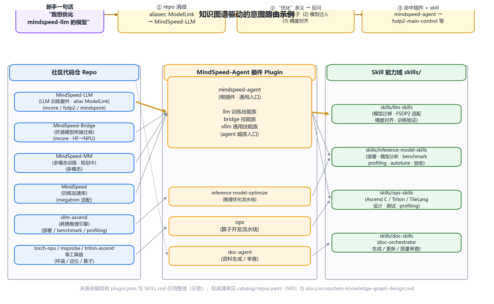
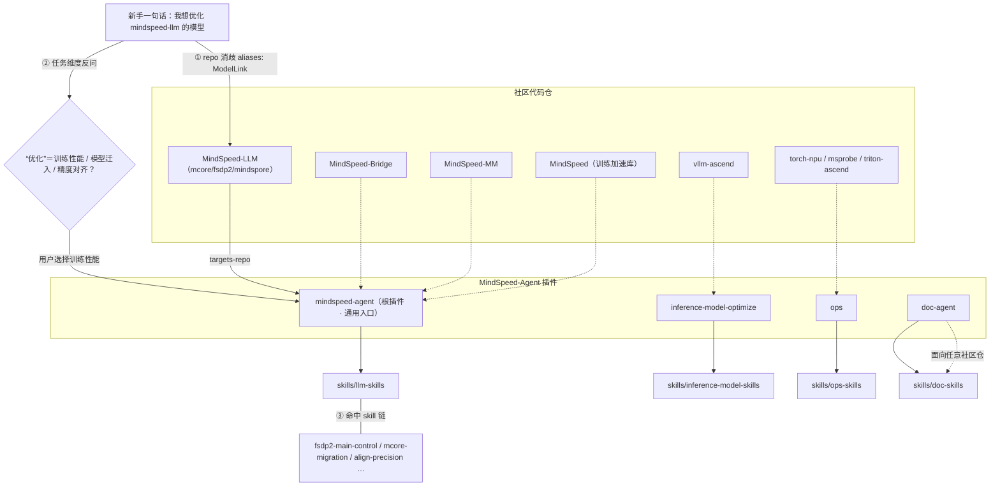

# MindSpeed 生态「仓库 ↔ 插件」知识图谱与新手意图路由设计

> 文档状态：设计稿 v0.1 → **已实现 v1.0**（catalog/ + 路由 skill + CI 门禁已落地，
> 见 §8 里程碑完成情况）
> 适用对象：MindSpeed-Agent 维护者
> 目标平台：DSH（DeepSeek Harness）/ Claude Code / Codex 三端一致
> 变更流程：本文件变更走独立 PR，评审要点见文末「评审清单」。

---

## 1. 背景与问题

MindSpeed-Agent 是面向 MindSpeed / Ascend 生态的多插件 Agent 仓库：根插件
`mindspeed-agent`（含通用 skills）+ 子插件（`inference-model-optimize`、`ops`、
`doc-agent` 等），同时被 Claude Code、Codex、DSH 三个平台以不同形态加载
（`.claude-plugin` / `.codex-plugin` / `.dsh/skills` 投影）。

当前各插件/SKILL.md 与**目标代码仓**（MindSpeed-LLM、MindSpeed-MM、vllm-ascend、
MindSpeed-Bridge…）的关系是**隐式**的：散落在各 skill 正文、路径和依赖说明里，
没有一份机器可读的"仓库 → 插件 → 能力 → Skill"索引。后果是：

- 完全不懂生态的新手只说一句"我想优化 mindspeed-llm 的模型"，模型需要从 40+
  个 SKILL.md description 里猜目标仓、猜插件、猜 skill，猜错成本高；
- 别名/新旧名（MindSpeed-LLM ↔ ModelLink）、口语（"mindspeed-llm" vs
  "MindSpeed-LLM"）、任务维度歧义（"优化" = 性能优化/迁移/精度对齐/算子融合？）
  无法用语义匹配稳定消歧；
- 三平台各自加载机制不同（Claude Code 按 plugin 计 30-skill 上限，Codex 读
  AGENTS.md，DSH 读扁平化 skills），缺一个统一的"先选对 plugin，再进 plugin
  加载 skill"的编排真相源。

### 1.1 目标

提供一份**声明式知识图谱 + 路由规则**，让任意平台上的 Agent 能把用户一句话解析为
可解释的调用链：

```text
"我想优化 mindspeed-llm 的模型"
   → {目标仓: MindSpeed-LLM, 任务: 优化, 后端: 待确认, 模型: 待确认}
   → repo → plugin → agent → skill（候选链 + 一行解释）
   → 唯一则执行；歧义则反问新手（不静默猜）
```

### 1.2 非目标（本期不做）

- 不建设独立的图数据库服务（Neo4j/Memgraph）作为运行时依赖；图谱以仓内
  YAML/JSON 文件为真相源，图语义在文件中表达（可选导出 GraphML/Mermaid 做可视化）。
- 不做多跳自由问答图谱（本期是"意图→路由"，不是 GraphRAG 问答系统；演进路径见 §9）。
- 不改动既有 SKILL.md 正文语义，只扩展**可选** frontmatter 字段（向后兼容）。

---

## 2. 现状盘点：仓库已有的"半张图"

| 已有资产 | 位置 | 与本设计的关系 |
| --- | --- | --- |
| 根插件三平台清单 | `.claude-plugin/plugin.json`、`.codex-plugin/plugin.json`、`.dsh-plugin/plugin.json` | 生成 `plugins.yaml` 的输入 |
| marketplace 清单 | `.claude-plugin/marketplace.json` | 插件集合的权威入口（4 个插件） |
| SKILL.md frontmatter | `skills/**/SKILL.md`（40+） | 图谱"能力/Skill 节点"的来源 |
| 领域/功能两级分类 | `skills/<domain>/<function>/<name>/` | 图谱的 `domain/function` 维度 |
| 路由型 skill 先例 | `skills/inference-model-skills/SKILL.md` | 路由 skill 写法范本 |
| 仓库路由参考 | `skills/llm-skills/model_migration/mindspeed-llm-mcore-open-model-migration/references/repository-routing.md` | 后端判定表可上收为图谱属性 |
| 清单驱动先例 | `plugins/doc-agent/templates/repo_manifest.yaml` | "单一真相源 + 确定性校验"范本 |
| 外部知识图谱接入先例 | `ascend-perf-tuning/SKILL.md`（Ascend KG + project-brain） | 演进期可选外部检索层 |
| 经验回写机制 | 仓库近期 commit（经验回写能力） | 意图样例的增量学习通道 |

---

## 3. 总体架构

采用**两层路由**：先做**确定性消歧**（查别名/关系表，不吃 LLM 幻觉），再交给
**语义路由**（平台原生 skill 匹配 + 候选确认）。

```text
┌──────────────────────────── 真相源（仓库内，三平台共享）───────────────────────────┐
│  catalog/repos.yaml         社区代码仓注册表（节点：Repo）                          │
│  catalog/plugins.yaml       本仓插件注册表（节点：Plugin，可半自动生成）            │
│  catalog/skill-graph.yaml   自动生成：SKILL.md frontmatter → Skill/能力节点          │
│  catalog/intent-examples.yaml 新手话术黄金测试集（回归用）                          │
└────────────────────────────────────────────┬──────────────────────────────────────┘
                                             │ generator.py 汇总 + 校验
                                             ▼
                        catalog/graph.json（一份跨平台统一索引）
                                             │
        ┌──────────────────────────────┬─────┴──────────┬──────────────────────┐
        ▼                              ▼                ▼                      ▼
 ┌───────────────┐          ┌─────────────────┐ ┌──────────────┐   ┌────────────────────┐
 │  确定性层      │          │  Claude Code    │ │   Codex      │   │   DSH               │
 │  别名表+关系表  │          │  .claude-plugin │ │  AGENTS.md    │   │  .dsh-plugin/skills │
 │  路由规则(§6)  │          │  路由 skill     │ │  路由说明     │   │  路由 skill         │
 └───────────────┘          └─────────────────┘ └──────────────┘   └────────────────────┘
        │                           所有平台共用同一份 graph.json + 路由规则（内容镜像）
        ▼
   意图解析（repo 消歧 → 任务维度 → 候选链 → 反问确认）→ 进入目标 plugin 加载其 skills
```

**平台差异只体现在"挂载形态"**（§6.2），路由逻辑本身是一份镜像文本。

### 3.1 可视化快照（README 生态地图）

为让完全不懂生态的用户一眼看懂"一句话 → 仓库 → 插件 → Skill 能力"的关系，
设计配套一张生态地图 `docs/ecosystem-map.png`，并呈现在仓库 README 的项目
架构章节中。图中展示三个泳道（社区代码仓 Repo / MindSpeed-Agent 插件
Plugin / Skill 能力域 skills/）及金色示例链路（意图路由示例），作为仓库级
新人地图。



> 生成与更新：`python tools/gen_ecosystem_map.py`（matplotlib + 中文字体，
> 布局自动堆叠并带重叠/溢出自检，改动后直接重跑即可）。图中关系为示意，
> 权威关系以 `catalog/repos.yaml`（M0）与本文档为准。以下为同构的 Mermaid
> 可编辑源码（gitcode/GitHub 支持渲染，可直接用于 PR 预览）：



---

## 4. 图模型（Schema）

### 4.1 节点类型

| 节点 | 含义 | 关键属性 | 来源 |
| --- | --- | --- | --- |
| `Repo` | MindSpeed 社区代码仓 | `id`（canonical）、`aliases`、`kind`（training/llm/mm/inference/ops/runtime/doc…）、`backends`、`urls`、`related`、`notes` | 人工维护 `repos.yaml` |
| `Plugin` | 本仓插件 | `id`、`platforms`、`repo_affinity`（处理哪些 Repo）、`agents`、`workflow` | 由各 `plugin.json` 生成 + 人工补 affinity |
| `Agent` | 插件内角色 | `id`、`belongs_to`（Plugin）、`bound_skills` | `plugins/*/agents/*` |
| `Skill` | 单一 SKILL.md | `name`、`domain`、`function`、`tags`、**`targets-repo`**、**`intent-examples`**、`depends_on` | `skills/**/SKILL.md` frontmatter |
| `TaskKind` | 任务维度（性能优化/迁移/精度对齐/部署/跑测…） | `id`、`aliases`、`trigger_words` | 人工维护（小枚举，见 §7） |

> `TaskKind` 也可并入 Repo 关系表；建议保留为独立小枚举，便于"任务→能力列"路由。

### 4.2 关系（边）

图谱边在 YAML 中用"归属/引用"表达，不单独建边文件：

| 边（语义） | 表达位置 |
| --- | --- |
| `Skill targets-repo Repo` | SKILL.md frontmatter `targets-repo: [mindspeed-llm]` |
| `Plugin handles Repo` | `plugins.yaml` 的 `repo_affinity: [mindspeed-llm]` |
| `Plugin mounts Skill` | 各 `plugin.json` 的 skills 列表（或目录规则） |
| `Agent belongs-to Plugin / binds Skill` | `agents/` 目录 + agent 文件内 skill 引用 |
| `Repo related-to Repo` | `repos.yaml` 的 `related` |
| `Repo has-backend Backend` | `repos.yaml` 的 `backends`（mcore/fsdp2/mindspore/vllm/triton…） |
| `Skill depends-on Skill` | SKILL.md 中"依赖 skill"声明（现有惯例，逐步结构化） |

### 4.3 SKILL.md frontmatter 扩展（可选，向后兼容）

```yaml
# 新增可选字段，缺失不影响既有加载
targets-repo:            # 该 skill 唯一/主要作用的社区仓（可多个）
  - mindspeed-llm
intent-examples:         # 新手会怎么问（用于路由回归与相似度示例）
  - "把 Qwen3-30B 迁到 mindspeed-llm 的 mcore"
  - "在 mindspeed-llm 上做 FSDP2 融合算子优化"
aliases: []              # 该 skill 的口语别名/曾用名（极少用，repo 层已覆盖）
```

规则：

1. `targets-repo` 的值必须能在 `repos.yaml` 的 `id` 或 `aliases` 中找到（CI 强校验）；
2. `intent-examples` 属于**人写金句**，禁止由 AI 凭空生成后直接入库（需人工确认），
   保证质量可回归；
3. 所有字段**可缺失**；缺失时 skill 仍可被语义匹配，只是不进确定性路由表。

---

## 5. 目录与文件结构（已落地）

```text
catalog/
├── repos.yaml              # Repo 节点 + 别名 + 后端 + 关联（人工，M0 ✅）
├── plugins.yaml            # Plugin 节点 + repo_affinity（M0 ✅）
├── task-kinds.yaml         # TaskKind 枚举（M0 ✅）
├── intent-examples.yaml    # 黄金话术 → 期望 {repo, task, plugin} 断言（M0 ✅）
├── loader.py               # YAML 加载 + R1 仓库消歧 / R2 任务命中实现
├── checks_core.py          # 校验核心（lint_catalog 与 CI 共用同一实现）
├── generator.py            # 汇总 repos/plugins/task-kinds + 扫 SKILL.md frontmatter
│                           #   → 输出 catalog/graph.json（M1 ✅）
├── lint_catalog.py         # 本地校验 CLI（M3 ✅）
├── graph.json              # 生成产物（gitignore，不入库）
└── README.md               # 维护手册：怎么加仓、加 skill、加样例
```

> 实现差异：设计稿中的 `catalog/skill-graph.yaml` 以生成产物 `graph.json`
> 代替（frontmatter 即为 skill 节点来源，无需第二份手写清单）；本地 CLI 与
> CI 共用 `checks_core.py` 同一实现，避免双份逻辑漂移。

产物（可选，不入评审主流程）：`catalog/graph.json`（gitignore 或随 CI 生成）、
`docs/ecosystem-map.md`（由 graph.json 渲染的 Mermaid 图谱，给新人看）。
可视化快照 `docs/ecosystem-map.png` 已落地（生成脚本 `tools/gen_ecosystem_map.py`，
见 §3.1）。

> CI 落地复用仓库既有确定性检查骨架 `ci/guard.py` + `ci/checks/`
> （现有 `marketplace.py`/`plugins.py`/`skills.py`/`workflows.py`），新增
> `ci/checks/knowledge_graph.py` 挂入同一入口，不另起炉灶。

---

## 6. 路由设计（三平台一致）

### 6.1 路由规则（确定性优先，镜像文本放三处）

```text
R1 仓库消歧：把用户话术与 repos.yaml 的 id/aliases 做【不区分大小写、去空格/连字符】
   匹配；命中 1 个 → 确定目标仓。0 个 → 语义候选 top-N，转 R4 反问。
   多个（如 MindSpeed-LLM vs MindSpeed 训练框架）→ 转 R4 反问区分。
R2 任务维度：从话术抽 trigger 词映射 TaskKind（性能/迁移/精度/部署/验证/算子…）。
   多义（"优化"）→ 列出该仓可用的 TaskKind 候选，转 R4。
R3 链路组装：目标仓 + TaskKind → plugins.yaml 的 repo_affinity ∩ TaskKind 能力列
   → 输出候选链 repo → plugin → agent → skill（附一行中文解释）。
R4 反问确认：候选唯一 → 直接进入目标 plugin 执行；否则向用户给出
   "二选一/多选一 + 每项一行解释" 的确认问题。绝不静默猜。
R5 兜底：图谱无命中 → 退化为现状语义匹配（读 skill description），并把该次话术
   记录为"待标注意图"，供后续人工补进 intent-examples.yaml。
```

### 6.2 三平台挂载形态

| 平台 | 挂载点 | 形态 |
| --- | --- | --- |
| Claude Code | `.claude-plugin/plugin.json` skills 目录 | 新增一个**路由 skill**（如 `skills/common/ecosystem-routing/SKILL.md`），description 用高频触发词（"我想…模型/仓库/插件/优化哪个仓"），正文指向 `catalog/` 并按 R1–R5 执行 |
| Codex | `.codex-plugin/plugin.json` + `AGENTS.md` | AGENTS.md 增加"路由须知"段 + 同一路由 skill（Codex 按目录加载）；遵循各插件 ≤30-skill 约束，路由 skill 放通用插件 |
| DSH | `.dsh/skills/<name>/SKILL.md`（安装脚本扁平投影） | 与 Claude Code 同一路由 skill 内容；投影自动包含新增 skill（见 `.dsh-plugin/plugin.json` 说明），无需额外清单注册 |

关键约束：Claude Code 每插件 30-skill 上限 → **路由 skill 必须放在根/通用插件**，
子插件不重复实现路由（对齐 `inference-model-skills` "只路由不重复" 先例）。

---

## 7. TaskKind 初版枚举（可扩展）

| TaskKind | 典型 trigger 词 | 代表性能力/插件 |
| --- | --- | --- |
| `perf-optimize` | 性能、优化、加速、吞吐、显存、autotune、寻优 | inference-model-optimize、ascend-perf-tuning、autotune |
| `migrate` | 迁移、适配、接入、移植、新模型、一键适配 | mindspeed-llm-mcore-open-model-migration、fsdp2-model-adaptation、bridge-model-adaptation |
| `align` | 精度、对齐、cosine、loss 对比、比对 | align-mindspeed-transformers-precision、bridge-precision-alignment |
| `deploy` | 部署、起服务、安装、环境、serving | vllm-ascend-serving、environment-install |
| `benchmark` | 压测、基准、吞吐测试、benchmark | vllm-ascend-benchmark、ascend-profiling-collection |
| `diagnose` | 定位、报错、二分、慢、卡死、profiling 分析 | version-bisect、ascend-msprof-analyze-cli、cann-package-split-diagnose |
| `ops-dev` | 算子、triton、ascend c、边界、生成算子 | ops 插件族（ops-design/ops-implement/ops-profiling…） |
| `doc` | 资料、文档、审资料、生成文档 | doc-agent |
| `validate` | 验证、跑测、远端训练、门禁 | bridge-remote-train-run、mindspeed-llm-remote-validation、validate-mindspeed-training-scenarios |

> 该表由维护者按 AGENTS.md 分类体系演进，不作为运行时硬编码。

---

## 8. 里程碑与验收

| 阶段 | 交付物 | 验收 | 状态 |
| --- | --- | --- | --- |
| M0 仓库注册表 | `catalog/repos.yaml` 首批 10–15 个真实仓（MindSpeed、MindSpeed-LLM、MindSpeed-MM、MindSpeed-Bridge、vllm-ascend、torch-npu、ModelLink 别名、Megatron 等），含 aliases/backends/urls | 金句 1：话术含 "mindspeed-llm" / "ModelLink" 均消歧到同一 Repo | ✅ 13 仓 + 金句 1/11 通过 |
| M1 图谱生成 | `generator.py` 扫 40+ SKILL.md → graph.json；frontmatter 补 `targets-repo` | 每条 skill 的 targets-repo 全部通过 lint；graph.json 可渲染 | ✅ 39 skill 扫描、31 skill 注入 targets-repo、38 条 skill↔repo 边 |
| M2 路由 skill | 通用插件新增路由 skill（三平台同一内容） | 金句 2（见下）三平台输出一致的候选链 | ✅ `skills/common/common/ecosystem-routing/SKILL.md` |
| M3 CI 门禁 | 新增 `ci/checks/knowledge_graph.py`，挂入既有 `ci/guard.py` 入口 | 别名冲突/孤儿 skill/样例断言 100% 通过 | ✅ guard exit 0 + pytest 31 passed |

**验收金句（三平台同一断言）**：

```text
输入："我想优化 mindspeed-llm 的模型"
断言：
  repo = MindSpeed-LLM（命中 aliases，非 MindSpeed 框架、非推理 vllm）
  输出候选：任务"优化"歧义 → 反问：
    (1) 训练侧性能/融合算子优化 → mindspeed-llm-fsdp2-main-control 等
    (2) 开源模型迁入该仓 → mindspeed-llm-mcore-open-model-migration 等
    (3) 精度对齐 → align-mindspeed-transformers-precision 等
  用户选 (1) 后进入对应插件/skill，不再重复询问仓库。
```

---

## 9. 演进路径（本期不实现，仅备案）

1. **向量/嵌入增强**：对 `intent-examples.yaml` + skill description 建索引，语义候选
   top-K 与确定性消歧融合（本地 bge-m3 或向量库均可，不进真图库）；
2. **经验回写自动化**：成功路由后把用户原话写入 `intent-examples.yaml`（复用仓库
   既有"经验回写"通道），CI 做覆盖回归；
3. **可视化已落地**：`docs/ecosystem-map.png`（生成脚本
   `tools/gen_ecosystem_map.py`）+ Mermaid 可编辑源码（§3.1）；下一步演进：
   当 `catalog/graph.json` 就绪后由 generator 自动重绘，替代/升级现有的
   `mindspeed-agent-four-layer-architecture.png`；
4. **GraphRAG（可选远期）**：若需多跳问答（"优化 Qwen3 会动到哪几个仓/插件"），
   将 catalog 导入 Kuzu/Neo4j 或注册进已有 Ascend KG 平台，复用 ascend-perf-tuning
   已跑通的"KG 检索 + score 阈值"范式。**不改变** R1–R5 确定性路由主链路。

---

## 10. 风险与决策点

| 风险/决策 | 说明 | 建议 |
| --- | --- | --- |
| 仓库注册表维护成本 | MindSpeed 社区仓多、改名频繁 | `id/aliases` 由维护者维护；URL 字段可定期用 GitCode/GitHub API 对账（不自动改 id） |
| 30-skill/插件上限 | Claude Code 每插件上限 | 路由 skill 只放根插件；子插件内 skill 通过 `targets-repo` 直接关联目标仓，无需重复路由 |
| 多义任务"优化" | 用户话术信息不足 | R4 反问是**特性不是缺陷**：宁可多问一句，不要猜错仓/后端 |
| frontmatter 扩展兼容性 | Claude/Codex/DSH 对未知字段容忍度 | 三个平台已确认忽略未知 frontmatter 字段；仍需在 CI 用最小 YAML 解析器校验格式 |
| 别名冲突 | 如 vllm-ascend 与 vllm 混淆 | repos.yaml 校验：alias 全局唯一（lint 强校验） |
| 文档自包含 | 不引用仓外基准文档 | 本设计为唯一真相源，引用仓库文件用相对路径 |

---

## 11. 评审清单（PR 合并前逐项检查）

1. [ ] `catalog/repos.yaml`：alias 全局唯一、kind/backends 取值合法、url 与社区源一致
2. [ ] SKILL.md frontmatter 扩展字段：`targets-repo` 值可解析到 repos.yaml；样例为人工确认
3. [ ] 路由 skill 三平台内容一致（Claude Code / Codex / DSH 镜像）
4. [ ] 路由 skill 位于根/通用插件，未在子插件重复实现
5. [ ] `lint_catalog.py` 门禁清单齐全并接入 CI
6. [ ] 金句断言用例进入 `intent-examples.yaml` 并通过
7. [ ] 未改动既有 SKILL.md 正文语义，仅增可选字段
8. [ ] 中文正文术语一致（昇腾/NPU/CANN/MindSpeed PascalCase），无中英混杂
