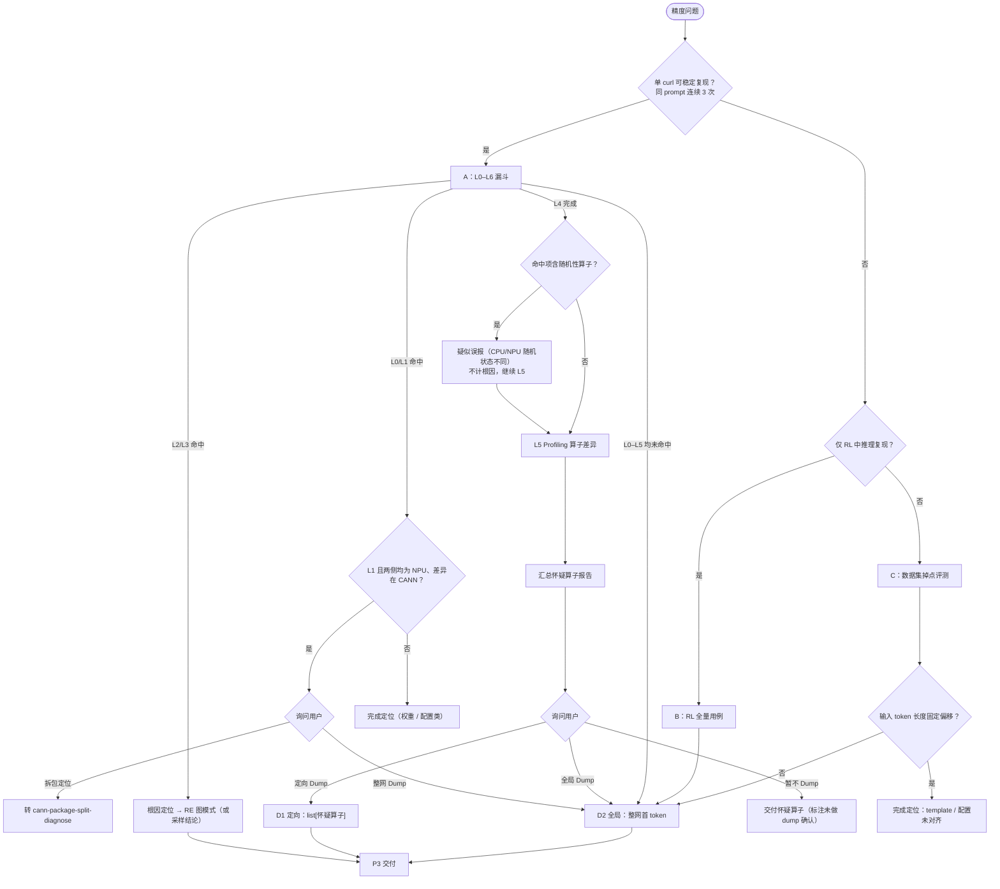

# dump-debug（vLLM-Ascend 推理精度定位）

## 功能概述

定位与排查 **vLLM-Ascend 在昇腾 NPU 上的推理精度与稳定性问题**。典型场景是“同一份配置/权重，
仅因运行模式或环境差异（图模式 vs eager、CANN 版本/环境切换等）导致输出错误”；同时覆盖
“仅 RL 推理复现”“数据集精度掉点”“请求崩溃”等入口。

方法分两阶段：**阶段一预检**先按变量顺序分层排除（权重 → 配置/版本 → 采样 → 图模式 →
算子预检 → Profiling），确认或排除根因；**阶段二 Dump** 再对需要算子级/整网级证据的问题做
整网采集与定向 tensor 核对，最终交付“可疑算子 + bad/good 输入输出数据 + 调用源码”。

### 问题形态定义

本技能所指的“一类问题”，判定前提是：**同一份权重、同一套服务配置下，唯一变量只有运行
模式或环境**。在这个前提下，输出错误表现为以下三种形态：

| 形态 | 英文 | 定义 | 判定方式 |
|------|------|------|----------|
| 乱码 | garbled | 输出不再是可解析的自然语言文本，而是无意义字符/符号序列（含编码错乱、非法 token 片段），无法还原语义 | 直接查看输出即可判定 |
| 复读 | repetition | 输出在同一 token、词组或句子上循环重复，无法正常推进或终止，语义停滞 | 重复 n-gram 占比高 / 输出卡死无法结束 |
| 错 token | wrong token | 输出仍是**可正常解码的合法文本**，但与 good 基线相比存在 token id 不一致的位置 | **token 级逐位比对**，见下 |

**与“模型能力不足/答非所问”的区分**：本类问题的判定依据不是“回答得对不对”，而是
**同配置同权重下 bad/good 输出不一致**——good 环境输出正确，说明缺陷来自运行模式或环境，
而不是模型本身。

#### “错 token”的判定口径

- **判据是 token 而不是语义**：不要用“答得对不对”判断。语义判断受主观理解与评测口径影响，
  人和 LLM 都可能给出互相冲突的结论；本技能一律以**同配置同权重下与 good 基线的 token 级
  不一致**作为判据。
- **必须给出首个不一致位置**：即“从第 N 个 token 起，bad 与 good 的 token id 不同”。拿不出
  该位置即视为证据不足，继续补 dump，不得直接下“错 token”的结论。
- **形态之间可以互相转化**：同一根因随偏差放大程度不同，可依次表现为错 token → 复读 → 乱码；
  因此形态只是现象分类，定位路径完全一致，都收敛到首个偏差算子。

三种形态的共同特征（用于判断“是否属于本类问题”）：

- **同源可比**：bad/good 使用同一份权重与同一套服务配置，唯一变量是运行模式或环境。
- **可复现**：固定随机性后 bad 稳定错、good 稳定对；若开启确定性后问题消失，则说明由
  非确定性算子触发（后续 dump 可先不开确定性，以保留坏路径现场）。
- **可逐级放大**：首个偏差算子的误差经层间传播与 KV cache 反馈被逐 token 放大，最终才
  表现为整段乱码/复读；因此必须收敛到**首个偏差算子**，而不是最后一个出错的算子。
- **定位口径一致**：三种形态都走同一套流程，并以“可疑算子 + 该算子 bad/good 输入输出
  dump 数据 + 调用源码”作为交付物。

整体方法抽象为一条**决策驱动的两阶段流程**：阶段一预检（分诊 + L0–L6 漏斗）→ 阶段二 Dump
（整网采集 → 定向 tensor 核对 → 结论汇报）。每个阶段有明确判定依据，依据不足先补证据再决策，
不靠猜测、不跳过前置阶段。流程以“定位 + 交付”收尾，**不做代码修复或版本验收**。

### 能力边界

| 场景 | 状态 | 约束 |
|------|------|------|
| 图模式 vs eager 纯推理精度 | 支持 | 必须同配置、同权重、同采样（如 temp=0）对比；图模式需装 aclgraph_dump 模块 |
| CANN 环境/版本差异乱码 | 支持 | 见 cases/ 案例库（用例A/B）；需记录 bad/good 两套 set_env/CANN |
| L0/L1 + statistics dump | 支持 | 参考 msprobe 官方文档；dump 只用于定位与交付，不作“修复验收” |
| tensor 级 scope dump | 支持 | 限定模块/算子 scope/list，减少噪声，保留输入输出 |
| git bisect 定位 | 支持（补充证据） | 在 last-known-good..HEAD 区间定位引入 commit，不作修复 |
| reduction 归约分析 | 支持 | 见 cases/ 用例A（all_reduce 归约簿记） |
| 多并发 dump 一致性 | 支持 | dump 16 条须先比对各条一致性再下结论 |
| NaN/Inf 特殊值对比 | 支持 | 数值 diff 无意义时走四类特殊值规则（见 debug-flow.md §5） |
| 单请求基线（3 次重放） | 支持 | 按内容（文本 / token ids）判定一致性并给出首个差异位置；token ids 需服务端 `return_token_ids=true`，logprob 漂移单独记录 |
| 精度控制矩阵（采样 / 图模式开关） | 支持 | 每格 ≥3 次，单变量回代才算命中 |
| 权重 / 配置 / 环境版本比对 | 支持 | 详见 `references/precheck-flow.md` §3 与 `scripts/` |
| 单算子精度预检（acc_check） | 支持 | `task:"tensor"` + `level:"L1"`；`warning` / `SKIP` 不算命中 |
| Profiling 算子差异比对 | 支持（复用） | 复用 `ascend-profiling-collection` / `ascend-msprof-analyze-cli` |
| 仅 RL 推理复现 | 支持（复用） | 复用 `model-rl-case-guard` 的减层权重与用例流程 |
| 数据集精度掉点 | 支持（复用） | 复用 `vllm-ascend-aisbench-accuracy` 做评测 |
| 数据集输入口径核对（template 对齐） | 支持 | 逐样本比对 bad/good 输入 token 长度与 prompt token id；固定偏移 → 疑 template / 配置未对齐，见 `references/precheck/prompt-template-alignment.md` |
| Batch 一致性问题 | 支持（转交） | 转 `batch-invariance-validation` 系列 skill |
| 训推一致性 | 仅建议 | 只输出排查方向，不执行训练侧对齐、权重转换核对 |
| 代码修复 / 版本落地 | 不支持 | 只定位并交付“可疑算子 + dump 数据 + 调用源码”，修复交由算子/版本团队 |

### 整体流程



阶段一预检按 **L0 → L6** 的变量顺序推进（权重 → 配置 → 采样 → 图模式 → 算子 → 整网），
L0–L3 命中即早退。**L4/L5 不早退**：L4 得到怀疑算子后继续做 L5，两层结果汇总成「怀疑算子
报告」，再询问用户选择**定向 Dump**（只采怀疑算子）还是**全局 Dump**（整网首 token 比对）。

其中 L4 报出的算子里，**随机性算子默认视为疑似误报**——CPU 标杆与 NPU 的随机状态（RNG 序列）
本来就不一致，输出必然不同，不能据此认定算子有缺陷；这类算子不计入根因，必须继续 L5。

整体状态：预检已确认配置类根因（权重 / 配置版本 / 采样 / 图模式开关 / 输入模板未对齐）时为 `TRIAGED`，无需进入
Dump；需要算子级证据且已交付“可疑算子 + bad/good I/O + 调用源码”时为 `CONFIRMED`；
L4/L5 得到怀疑算子但用户未选择 Dump、或证据不足时为 `PARTIAL` / `BLOCKED`。

## 使用方式

- 直接调用：`/mindspeed-agent:dump-debug`。
- 或描述精度异常定位 / 图模式-eager 不一致 / reduction / CANN 环境差异乱码排查需求，
  由上下文自动匹配。

执行前确认以下信息：

| 参数 | 要求 |
|------|------|
| 模型 | 目标模型绝对路径及架构 |
| 芯片 | A2/A3/A5，用于判断是否需图模式模块；显式设置 `ASCEND_RT_VISIBLE_DEVICES` |
| 并行配置 | TP/DP/EP 全流程开始前确认；记录完整拓扑 |
| 采样配置 | temperature、seed；定位期间必须固定（逐项清单见阶段一“固定随机性”） |
| 调度配置 | max-model-len、max-num-seqs、显存利用率；prefix caching、chunked prefill 是否开启 |
| 复现脚本 | URL、`model`、完整请求体、期望输出与实际输出；单 curl 能否稳定复现 |
| 环境与基线 | 是否有 GOOD 基线（双环境 / 双路径）；两侧 CANN 与 `set_env` |
| target | 全量定位、指定阶段、失败复现或异常定位 |
| 运行记录目录 | 本次定位唯一的绝对路径；保存配置、dump、日志、汇总和最终报告 |

详细执行步骤见 [references/precheck-flow.md](references/precheck-flow.md)（阶段一预检）与
[references/debug-flow.md](references/debug-flow.md)（阶段二 Dump）。

## 环境确认（预检前置）

完整读取并严格执行 `references/precheck-flow.md` §2 与 `references/debug-flow.md` §2。要点：

- 采集实际运行环境：`bash scripts/audit_vllm_ascend_env.sh > env_<side>.txt`；记录 vllm /
  vllm-ascend 的 `__file__`、版本、`git rev-parse HEAD` 与 dirty 状态，不要用目录名代替。
- 确认 msprobe 已安装（`which msprobe` / `pip show mindstudio-probe`）；未安装按
  `references/msprobe/install_guide.md` 安装；用 `bash scripts/audit_msprobe_env.sh` 记录
  实际导入路径、版本与标杆注册情况。
- 图模式采集需源码编译打入 **aclgraph_dump 模块**；在线/离线基础包不含该模块。
- 记录 bad/good 各自的 `set_env` / CANN 路径与版本（`msprobe compare` 需要两套环境切换）。
- 避开 CWD 下 `profile.py` 遮蔽标准库的坑：`cd` 到 vllm 目录后再启动 serve。

## 阶段一：预检分诊（L0–L6）

完整读取并严格执行 `references/precheck-flow.md`。要点：

- **入口分诊**（先决定走哪条分支）：
  - E1 单 curl 可稳定复现 → A 分支（L0–L6 漏斗）。
  - E2 单推不复现、仅 RL 中复现 → B 分支（`references/precheck/rlhf-e2e-triage.md`）。
  - E3 单 curl 正常但数据集掉点 → C 分支（数据集评测 + bad case 分析）。
  - 其他：请求崩溃 → `references/precheck/ascend-error-signatures.md`；无法稳定复现 →
    训推一致性**仅输出建议**，不代为执行。
- **现场固化**：复现脚本、3 次原始响应（文本 / token ids / logprobs；token ids 需服务端
  `return_token_ids=true`，老版本不返回时退化为文本比对，并在报告「限制」中声明）、环境快照。
- **固定随机性**：逐项固定下列随机源，`SEED` 取固定值并在整轮定位中复用（缺一项 bad/good 就不可比）：
  - 语言/框架：`random.seed(SEED)`、`np.random.seed(SEED)`、`torch.manual_seed(SEED)`。
  - 昇腾运行时：`torch_npu.npu.manual_seed(SEED)`；多卡用 `torch_npu.npu.manual_seed_all(SEED)`。
  - 网络：关闭 dropout（`model.eval()` / `rm_dropout=True`）。
  - 采样：`temperature=0`（贪心）并固定 `seed`，不做 top_p/top_k 随机采样。
  - 确定性开关：算子 `torch.use_deterministic_algorithms(True)`、通信 `export HCCL_DETERMINISTIC=TRUE`。
  - 一次性设置：msprobe `from msprobe.pytorch import seed_all; seed_all(seed=SEED, mode=True, rm_dropout=True)`。
  - 同一个 `SEED` 写入运行记录目录，bad/good 两次启动复用；变更记入环境变量变更清单。
- **A 分支 L0–L6（按变量顺序逐层排除，命中即早退）**：

  | 层 | 检查 | 命中出口 |
  |----|------|----------|
  | L0 | 权重校验（`scripts/compare_model_dirs.py`） | 完成定位（权重） |
  | L1 | 配置与环境比对（三方库版本 + GPU 侧日志超参 + 脚本 diff） | 完成定位（配置 / 版本）；**两侧均为 NPU 且比出 CANN 差异 → 询问走拆包定位还是整网 Dump** |
  | L2 | 开关采样（`temperature=0` + 固定 seed，3 次重放） | 完成定位 / 非确定性命中 |
  | L3 | 开关图模式（`--enforce-eager` 对照） | 根因定位 → 阶段二 RE |
  | L4 | 算子精度预检（`msprobe acc_check`，`scripts/run_msprobe_api_precheck.sh`） | 得到怀疑算子；**随机性算子判为疑似误报，不结束流程**，继续 L5 |
  | L5 | Profiling 算子差异（复用 `ascend-profiling-collection` / `ascend-msprof-analyze-cli`） | 与 L4 结果汇总为怀疑算子报告 → **询问定向 Dump 还是全局 Dump** |
  | L6 | 无更便宜手段，转整网 Dump | 阶段二 D2（全局 Dump） |

- **L1 的 CANN 差异分支（NPU vs NPU）**：当两侧**都是 NPU 环境**（两套 NPU 服务脚本 / 两套
  NPU 环境），比对结论是 **CANN 差异**（toolkit / nnal / ops 版本或子包不同）时，**必须询问
  用户二选一**，不得自行决定：

  | 选项 | 适用 | 做法 |
  |------|------|------|
  | 拆包定位 | 想直接定位到 CANN 的具体子包/组件 | 转本仓 skill `cann-package-split-diagnose`，按 toolkit / nnal / ops 逐层二分 |
  | 整网 Dump 比对 | 想先用数值证据确认「CANN 差异是否真的导致精度问题」 | 走阶段二 D2 全局 Dump（bad vs good 首 token 整网比对） |

- **L4 的随机性算子排除**：`acc_check` 报 `error` 的若属于随机性算子（`Dropout` / `rand*` /
  `bernoulli` / `multinomial` / 采样类等），默认判为**疑似误报**——CPU 标杆与 NPU 的 RNG 状态
  不同，同输入输出必然不同。处理方式：
  - 记为「已排除（随机性）」，不写入根因，**流程继续到 L5**；
  - 想进一步确认时，关闭随机源（`model.eval()`、`rm_dropout=True`、去采样）后重跑同一预检，
    报错消失即确认误报；若仍报错，说明该算子确有数值问题，转为高优先级怀疑算子。
- **L4/L5 汇总后再问 Dump 范围**：两层都完成后输出「怀疑算子报告」（算子名、来源层、
  证据文件、置信度、已排除项），再询问用户走**定向 Dump**还是**全局 Dump**。
- **B 分支（仅 RL 复现）**：跑全量 RL 用例，可用「模型减层 + 复用脚本特性」加速（复用
  `model-rl-case-guard`）；执行顺序 `test_pause_resume.py` → `test_sleep_wake.py` → 全量
  `rlhf` 目录；出现 bad case 进阶段二分流。
- **C 分支（数据集掉点）**：复用 `vllm-ascend-aisbench-accuracy` 跑全量评测 → **先做 C2 输入口径
  核对**（`scripts/compare_input_tokens.py`：同一句输入的 bad/good 输入 token 长度若为固定偏移
  d≠0，高度怀疑配置未对齐导致推理 template 不一致，按 `references/precheck/prompt-template-alignment.md`
  核对并单变量回代，确认后记 `TRIAGED`、不进 Dump）→ 输入对齐后再看单推掉点：掉点 → 分析
  bad case（开确定性是否复现）；不掉点 → 统计首 token 对齐率等分布，**仅建议**走训推一致性。

> 判定纪律：L0–L3 的“命中”必须单变量回代；L4 的 `warning` / `SKIP` 既不算命中也不算通过；
> 随机性算子报错默认视为误报，不计根因、不结束流程；L4/L5 都完成后才汇总并询问 Dump 范围；
> **L1 命中 CANN 差异（两侧均为 NPU）时必须询问走拆包定位还是整网 Dump**；
> **C 分支先做 C2 输入口径核对**：输入 token 长度固定偏移时先按 template / 配置未对齐处理；
> 每层证据立即落盘；禁止跳级。

## 阶段二：Dump 分流（D1 / D2 / D3 / RE）

预检给出「怀疑算子 / 可疑层 / bad case」后，先由用户选定 Dump 范围，再进入对应路径：

| 路径 | 条件 | 做法 |
|------|------|------|
| D1 定向 Dump | 怀疑算子明确，且用户选择定向 | `task:"tensor"` + `list:[怀疑算子]`，bad/good 各一份，逐元素比对（P2） |
| D2 全局 Dump | 用户选择全局，或 L0–L5 均未命中（L6） | 首 token（`step:[0]`）整网模块级 dump → `msprobe compare` → API 级定向 → P2 |
| D3 Batch 一致性 | 换 batch / 并发结果就变 | 转 `batch-invariance-validation` 系列 skill，本技能不重复实现 |
| RE 图模式问题 | L3 命中图模式 | 图 / 非图各采一份，先比图模式独有的融合算子与层，再定向 API 级 / P2 |

> 进入 D1/D2 前若来自 L4/L5，必须先给出「怀疑算子报告」并由用户选定范围；用户选择暂不 Dump 时，
> 按 P3 交付怀疑算子，并在报告中标注“未做 dump 确认”（整体状态 `PARTIAL`）。
>
> **CANN 差异分支**：L1 在「两侧均为 NPU」的环境间比出 CANN 差异时，不进入上表，而是先询问
> 用户——走本仓 skill `cann-package-split-diagnose`（拆 toolkit / nnal / ops 逐层二分），
> 或改走 D2 全局 Dump（用数值证据确认该 CANN 差异是否真的致因）。

## P1 分级 Dump 定位（模块级 → API 级）

完整读取并严格执行 `references/debug-flow.md` §4。要点：

- 先用**模块级**（`level:"L0"` 或 `mix`）找疑似**模块**，`msprobe compare` 比对 bad/good，排除整型
  count/index 假偏差，找**首个偏差模块**。
- 再在模块内用**API 级**（`level:"L1"` + `scope`/`list`）锁定**首个 `Result!=pass` 的具体算子**。
- 定位到具体算子后，**必须保存该算子输入输出**（bad/good 各一份）。

## P2 细粒度 tensor Dump（限定目标算子/模块）

完整读取并严格执行 `references/debug-flow.md` §5。要点：

- 配置 `task:"tensor"` + `list:[目标算子]`（`data_mode:["all"]` 保留输入输出 `.pt`），bad/good 各一份。
- 逐元素配对比较（`torch.load` + `abs(bad-good)`）；遇 NaN/Inf 走特殊值四类规则。
- **判定分流**：输入一致、输出首偏 → 算子内核自身偏差；输入已偏、输出跟随 → 回溯上游首偏点。

## P3 结论汇报与最终输出格式

完整读取并严格执行 `references/debug-flow.md` §6 与 `references/final-report.md`。要点：

- 汇报**怀疑的具体算子** + 判定依据，并将最终报告保存为 `<RUN_RECORD_DIR>/precision_debug_final_report.md`。
- 最终输出按固定小节结构：定位结论 / 证据表格 / 交付数据（放运行脚本路径下 `dump_output/`）/
  调用该算子的源码（`文件:行` + 代码片段）/ 备注。
- **结论铁律**：dump 定位本身不能替代交付——最终交付必须以“可疑算子 + 其 bad/good 输入输出
  dump 数据 + 调用源码”为准；不收敛时先补 dump 证据再下结论。

## 异常分析定位分支

两种典型问题形态的详细定位流程见 references/cases 案例库：

- [分支 A：图模式 vs eager（MoE 归约）/ 归约乱码（用例A：all_reduce）](references/cases/01_cann_upgrade_garbled_all_reduce.md)
- [分支 B：CANN 环境/版本差异 → 乱码/复读（用例B：FIA）](references/cases/02_cann_env_diff_garbled_fused_infer_attention.md)

完整读取并严格执行对应分支文档；首 token 乱时只需采集 `step:[0]` 整网即可，不必全量/多步。

## 验证结果

完整读取并严格执行 `references/final-report.md`，将最终报告保存为：

```text
<RUN_RECORD_DIR>/precision_debug_final_report.md
```

每完成一个阶段必须先将交付件落盘并更新报告中的清单，才能给出阶段结论。不得填写不存在的
证据路径，也不得用平均精度、下游 skill 成功状态或 pytest footer 替代阶段通过证据。

## 注意事项

- **方案先行、不改代码**：用户明确要求“先给方案”时，先分析输出方案，不立即改代码/加 dump。
- **只 dump 第 0 条 vs dump 16 条**：dump 16 条必须比对一致性后再下结论。
- **JSON 引号**：`--additional-config`/`--compilation_config` 等 JSON 参数在 PowerShell 下单引号
  内双引号要 `\"` 转义，否则 vllm JSON 解析失败。
- **确定性**：对比前开启确定性以保证 bad/good 可比；交付后按需还原。
- **SSH PTY 缓冲**：长输出会被截断/分页——尽量小段执行、用 `grep`/`git show` 加 `--no-pager`；
  必要时用 SFTP 拉回本地分析。
- **杀进程后查显存**：`pkill` 后确认 `npu-smi` 显存已释放再重启，僵尸占显存会 OOM。
- **并发预算**：可读服务端 `Maximum concurrency` 日志推算并发档位。

## 参考信息

### 流程与报告

| 路径 | 用途 |
|------|------|
| `references/precheck-flow.md` | 阶段一预检：入口分诊 + L0–L6 漏斗 + B/C 分支 + 判定铁律 |
| `references/debug-flow.md` | 阶段二 Dump：环境确认 → P1-P3 + 判定分流、确定性、操作纪律、速查 |
| `references/final-report.md` | 最终报告模板、状态判据与 P3 交付格式 |

### 预检专项参考

| 路径 | 用途 |
|------|------|
| `references/precheck/two-environment-diff.md` | GOOD/BAD 双环境权重、脚本、版本的比对细则与因果矩阵 |
| `references/precheck/prompt-template-alignment.md` | 输入口径核对与推理 template 对齐：固定偏移成因、核对清单、单变量回代与报告写法 |
| `references/precheck/msprobe-api-precheck.md` | msProbe 真实张量采集、`acc_check`、结果判定与 GPU 比对边界 |
| `references/precheck/rlhf-e2e-triage.md` | RL-only 分支：RLHF 用例回移、适配、执行顺序与污染排查 |
| `references/precheck/ascend-error-signatures.md` | 昇腾/vLLM 常见错误签名与定位方向 |

### 脚本

| 路径 | 用途 |
|------|------|
| `scripts/audit_vllm_ascend_env.sh` | 采集 vllm/vllm-ascend 实际路径、版本、commit、CANN 与 NPU 信息 |
| `scripts/audit_msprobe_env.sh` | 采集 msProbe 实际导入路径、版本、标杆注册情况 |
| `scripts/collect_ascend_evidence.sh` | 采集进程、端口、日志与关键错误签名 |
| `scripts/compare_input_tokens.py` | 逐样本比对 bad/good 输入 token 长度与 prompt token id，按固定偏移判定 template / 配置未对齐 |
| `scripts/compare_precision_runs.py` | 按温度与重复次数发起请求，按内容（文本 / token ids）判定确定性并给出首个差异位置；logprob 漂移单独记录 |
| `scripts/compare_model_dirs.py` | 比较两套模型目录的清单、大小与哈希 |
| `scripts/run_msprobe_api_precheck.sh` | 多 rank 批量 `acc_check` 并汇总 pass/warning/error/SKIP |
| `scripts/install_msprobe_fia_bench.py` | 安装并注册 `npu_fused_infer_attention_score` 的 CPU 高精度标杆（需自备 `--asset` 实现） |

### msprobe 官方文档

| 路径/入口 | 用途 |
|-----------|------|
| `references/msprobe/install_guide.md` | msProbe 安装指南（在线/离线/源码、aclgraph_dump 模块） |
| `references/msprobe/dump/vllm_dump_instruct.md` | vLLM dump 说明 |
| `references/msprobe/best_practices/infer_debug_guide.md` | 开启确定性 |
| `references/msprobe/best_practices/dump_enable_guide.md` | 常见框架 Dump 工具使能与添加位置查找（SGLang/verl 参考） |
| `references/msprobe/developer_guide/msprobe_guide.md` | vllm-ascend dump/scope 使用说明 |
| `references/msprobe/dump/config_json_introduct.md` | dump 配置文件说明 |
| `references/msprobe/dump/data_parse_instruct.md` | dump 数据解析 |

### 案例库

| 路径 | 用途 |
|------|------|
| `references/cases/README.md` | 乱码案例知识库索引（all_reduce / FIA） |
| `references/cases/01_cann_upgrade_garbled_all_reduce.md` | 用例A：CANN 升级 all_reduce 乱码 |
| `references/cases/02_cann_env_diff_garbled_fused_infer_attention.md` | 用例B：CANN 环境差异 FIA 乱码（Moonlight-16B-A3B） |
