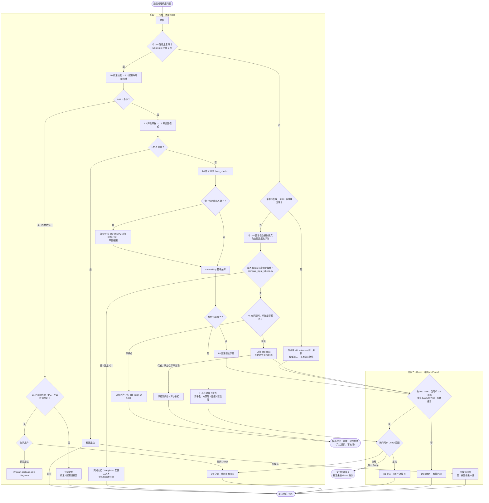

# 预检与 Dump 流程（详细）

> 本文件是 SKILL.md「预检分诊」的执行细节依据。整体分两个阶段：**阶段一 预检**负责把问题
> 归类到正确分支并尽量用便宜手段直接定出根因；**阶段二 Dump**只在需要算子级/整网级数值
> 证据时启动。只有「单 curl 可复现」分支会走完整的 L0–L6 漏斗。
> 说明：本文中 `references/...`、`scripts/...` 均相对技能根目录。

## 目录

1. 总览
2. 入口分诊
3. A 分支：单 curl 可复现（L0–L6）
4. B 分支：单推不复现，仅 RL 复现
5. C 分支：单 curl 正常但数据集掉点
6. 阶段二：Dump 分流
7. 判定铁律与证据落盘
8. 分支速查与跨 skill 交接

## 1. 总览

## 2. 入口分诊

进入任何分支前先回答三个问题，并固化现场。

| 闸门 | 判据 | 去向 |
|------|------|------|
| E1 单 curl 可复现 | 同一 prompt、同一 `max_tokens` 连续 3 次稳定复现同一异常 | §3 A 分支 |
| E2 单推不复现、仅 RL 复现 | 单请求正常；RL rollout / pause-resume / sleep-wake 后才出现 | §4 B 分支 |
| E3 数据集掉点 | 单请求正常、无 RL 路径；数据集评测指标下降 | §5 C 分支 |
| 其他 | 请求崩溃 / 无法稳定复现 | 崩溃走 `references/precheck/ascend-error-signatures.md` 读首个 traceback；无法复现走训推一致性兜底 |

**现场固化（三项缺一不得开始）**：

1. 复现脚本：URL、`model`、完整请求体、期望输出、实际输出。
2. 三次请求的原始响应：文本、token ids、logprobs、状态码（token ids 需服务端
   `return_token_ids=true`；老版本不返回时按文本比对，并在报告「限制」中声明）。
3. 环境快照：`bash scripts/audit_vllm_ascend_env.sh`（+ `audit_msprobe_env.sh`）。

## 3. A 分支：单 curl 可复现（L0–L6）

按变量顺序逐层排除、命中即早退：**L0 权重 → L1 配置与环境 → L2 采样 → L3 图模式 →
L4 算子预检 → L5 Profiling → L6 整网 Dump**。L0–L3 命中即完成定位或转入对应路径；
**L4/L5 命中只输出怀疑算子，是否继续 Dump 由用户决定**。

### 3.1 数据与配置层（L0–L1）

| 层 | 假设 | 操作 | 命中判据 |
|----|------|------|----------|
| L0 权重校验 | 两侧不是同一份权重 | `scripts/compare_model_dirs.py --good <A> --bad <B>`；`readlink -f` + 容器挂载检查；小文件全量 SHA256、大分片抽样或 `--hash-mode all` | 清单/分片/大小/关键哈希不一致；或同路径经不同挂载看到不同内容 |
| L1 配置与环境比对 | 超参、环境变量或版本差异 | ① `audit_vllm_ascend_env.sh` ×2 + `diff`；`pip freeze` diff；CANN/NNAL/ATB/driver；vllm / vllm-ascend 的 `__file__` + commit + dirty。② **GPU 侧配置比对**：从 GPU/GOOD 日志与脚本提取 dtype、量化、TP/PP/DP/EP、`max-model-len`、attention backend、`VLLM_*`。③ `diff -u serve_{good,bad}.sh`、`client_{good,bad}.sh` | 存在与精度相关的差异；端口/日志名等无关项可忽略但须写理由 |

单一环境（无 GOOD 基线）时，L0 改为与发布权重比对、L1 改为与官方版本矩阵/GPU 侧配置比对，
并在报告「限制」中声明。

#### 3.1.1 CANN 差异分支（两侧均为 NPU）

**触发条件**：L1 比对的两侧**都是 NPU 环境**（两套 NPU 服务脚本 / 两套 NPU 环境，不是
NPU vs GPU），且差异落在 **CANN**（toolkit / nnal / ops 的版本或子包不同）。

**处理**：不要直接判为根因，也不要直接进入 Dump，而是**询问用户二选一**：

| 选项 | 适用场景 | 做法 |
|------|----------|------|
| 拆包定位 | 想直接定位到 CANN 的具体子包/组件 | 转本仓 skill `cann-package-split-diagnose`：先拆 toolkit / nnal / ops 三个子包，再进一步拆 ops 的组件，逐层二分到具体子包或组件 |
| 整网 Dump 比对 | 想先用数值证据确认「CANN 差异是否真的导致精度问题」 | 走阶段二 D2 全局 Dump：bad / good 各采首 token 整网，`msprobe compare` 确认是否存在数值分歧 |

**记录要求**：无论选哪条，都要在报告里写明两侧 CANN 的完整版本组合（toolkit / nnal / ops
各自的版本号与安装路径），以及用户的选择与理由。若用户选择拆包定位，本 skill 的流程到此为止，
不继续 Dump。

### 3.2 开关层（L2–L3）

| 层 | 假设 | 操作 | 命中判据 |
|----|------|------|----------|
| L2 开关采样 | 采样/随机性导致输出不稳定 | `temperature=0` + 逐项固定随机源（见 SKILL.md 阶段一「固定随机性」）；`scripts/compare_precision_runs.py --temperatures 0 1 --repeats 3` | 关闭后内容（文本 / token ids）稳定**且输出正确**；关闭后内容仍漂移 → 判为「非确定性」，同样命中；logprob 漂移单独记录，不作判据 |
| L3 开关图模式 | 图模式（ACLGraph/图编译）引入差异 | 同脚本同权重，仅切换 `--enforce-eager`（或 cudagraph 开关），各跑 3 次 | 仅一侧复现 |

**L2 的两种非命中**必须区分并记录：

- 关闭后稳定但仍乱码 → 确定性正常、正确性异常 → 未命中，进 L3。
- 关闭后现象不变且每次仍不同 → 属非确定性命中，不要当「未命中」。

### 3.3 算子层（L4–L5）

| 层 | 假设 | 操作 | 命中判据 |
|----|------|------|----------|
| L4 算子精度预检 | 某算子相对 CPU 标杆数值异常 | `audit_msprobe_env.sh` → `task:"tensor"` + `level:"L1"` 真实张量 → 逐 rank `msprobe acc_check`（多 rank 用 `scripts/run_msprobe_api_precheck.sh`） | `accuracy_checking_result_*.csv` 出现 `error`；或 `details_*.csv` 低余弦、`inf/nan`、可复现翻转。`warning` / `SKIP` **都不算命中** |
| L5 Profiling 算子差异 | 两侧算子选择不同（融合/替换/fallback/额外 cast） | 相同 prompt、step、warmup 下两侧采集；复用 `ascend-profiling-collection`（采集）、`ascend-msprof-analyze-cli`（分析）；对齐算子清单与调用次数 | 同一层出现算子选择差异 |

**L4 的随机性算子误报（重要）**：`acc_check` 的 CPU 标杆与 NPU 的**随机状态（RNG 序列）不同**，
随机性算子在同一输入下输出本来就会不同，因此报 `error` 不能作为缺陷证据。判定与处理：

| 情况 | 处理 |
|------|------|
| 报错算子属于随机性算子（`Dropout` / `rand*` / `randn` / `bernoulli` / `multinomial` / 采样类等） | 记为「**疑似误报 · 随机性**」，**不计入根因、不结束流程**，继续 L5 |
| 关闭随机源（`model.eval()` / `rm_dropout=True` / 去采样）后重跑，报错消失 | 确认误报，写入「已排除项」 |
| 关闭随机源后仍报错，或报错算子本身无随机性 | 保留为**高优先级怀疑算子** |
| 无法判断算子是否含随机性 | 先按误报处理，降为低优先级，由 L5 交叉验证 |

> 禁止把「随机性算子 acc_check 不通过」直接写成根因并结束流程。

**L4/L5 的汇总出口（重要）**：L4 与 L5 **都执行完**后，汇总成「怀疑算子报告」，再询问用户
选择 Dump 范围：

- 报告内容：怀疑算子名、来源层（L4/L5）、证据文件、置信度（高/低）、已排除项（含随机性算子
  排除记录）。
- 用户选**定向 Dump** → 阶段二 D1（`task:"tensor"` + `list:[怀疑算子]`）。
- 用户选**全局 Dump** → 阶段二 D2（整网首 token）。
- 用户选暂不 Dump → 按 P3 交付怀疑算子与判定依据，报告中标注「未做 dump 确认」，状态 `PARTIAL`。

**L4 的两个边界情况**：

- `SKIP: There is not bench function ...` 表示缺 CPU 高精度标杆，**不是通过**。按
  `references/precheck/msprobe-api-precheck.md` §5 补 bench function 后重跑；FIA 可用
  `scripts/install_msprobe_fia_bench.py --asset <自备实现>` 安装注册（本技能不内置标杆实现）。
- 只有 NPU 侧单环境时，只能完成「NPU vs CPU 标杆」预检；GPU 侧 `acc_check` 与
  `api_precision_compare` 未执行，必须在报告「限制」中写明。

### 3.4 L6 收尾

L0–L5 全未命中（含 L4/L5 无有效怀疑算子）→ 无更便宜手段，转入阶段二 D2 全局 Dump。
`L6` 本身不产出新证据，只作为「预检结束、交 Dump」的标记。

**成本与证据**

| 层 | 成本 | 命中出口 | 主要证据 |
|----|------|----------|----------|
| L0 | 分钟–小时（哈希） | 完成定位（权重） | `model_diff_*.json`、`sha256sum_*.txt` |
| L1 | 分钟 | 完成定位（配置/版本） | `version_diff.txt`、`env_diff.txt`、`serve_diff.patch` |
| L2 | 分钟 | 完成定位（采样/非确定性） | `replay_{on,off}_*.jsonl`、`determinism_matrix.csv` |
| L3 | 10–30 分钟 | 根因定位 → 阶段二 RE | `graph_vs_eager_*.csv` |
| L4 | 小时 | 怀疑算子（随机性算子计为误报） → 继续 L5 | `accuracy_checking_{result,details}_*.csv` |
| L5 | 小时 | 与 L4 汇总 → 询问定向 / 全局 Dump | `op_summary.csv`、`op_diff.csv` |

## 4. B 分支：单推不复现，仅 RL 复现

进入条件：E1 不成立（单请求 3 次正常），但经过 RL rollout、权重同步、pause/resume、sleep/wake
或多轮状态切换后出现异常。**不要用普通单请求通过来否定问题。**

流程：

1. 检查实际 vLLM-Ascend 路径下是否存在 `tests/e2e/pull_request/one_card/rlhf`；缺失按
   `references/precheck/rlhf-e2e-triage.md` 回移。
2. 跑全量 RL 用例；可用「**模型减层 + 复用脚本特性**」加速：复用
   `model-rl-case-guard` 的减层随机权重能力（保留基础结构、只减解码层），明确标注为功能验证，
   不用于真实精度验收。
3. 执行顺序固定：`test_pause_resume.py` → `test_sleep_wake.py` → 全量 `rlhf` 目录。
4. 出现 bad case → 进阶段二 §6 的 FD 分流。
5. 排查测试框架污染：模块导入期设置 `os.environ[...]`（如被 skip 的 FA3 用例设了
   `VLLM_BATCH_INVARIANT=1`）会污染整个 pytest 进程；应改为只在用例执行时生效的 fixture。

## 5. C 分支：单 curl 正常但数据集掉点

进入条件：E1 不成立、也无 RL 状态切换路径，但数据集评测指标下降。

流程：

1. 跑全量数据集评测（复用 `vllm-ascend-aisbench-accuracy`），归档实际配置、原始指标与结果路径。
2. **C2 输入口径核对（template 对齐）**——先比输入再比输出：两侧输入不一致时，精度数字本身
   不可比，后续 bad case 分析与 Dump 全部作废。
   - 工具：`scripts/compare_input_tokens.py`（两侧服务还在时用 `--bad-url/--good-url` replay；
     服务已停时用 aisbench 结果里的 prompt + 输入长度走 record 模式），细则见
     `references/precheck/prompt-template-alignment.md`。
   - **固定偏移**（每条样本差值都是同一个 d≠0，样本 ≥ `--min-pairs`，占比 ≥ `--dominance`）
     → 高度怀疑**配置未对齐导致推理 template 不一致**（chat template / system prompt / BOS /
     add_generation_prompt / tokenizer 版本）：按该文档 §4 逐项核对、§5 单变量回代；确认后记
     `TRIAGED`，**不进 Dump**，对齐后重跑评测。
   - **偏移不固定** → 不是固定模板差 → 转 tokenizer 版本与数据集构造差异，继续 3。
   - **长度一致但 token id 不同** → tokenizer / vocab / special token 不一致，同上。
   - **长度与 token id 全部一致** → 输入口径对齐，继续 3。
   - 证据落盘：`input_len_diff.jsonl`（逐样本 good/bad 长度与 delta）、`input_len_summary.json`
     （verdict、delta 分布、首个差异 token 与片段）。
3. 判定 **SB：RL 有问题时，单推是否掉点？**
   - **掉点** → 进入 4。
   - **不掉点** → 进入 5。
4. **RM 分析 bad case**：挑出掉点样本，逐条用单请求回放；再开确定性看是否复现。
   - 出现可单 curl 复现的 bad case → 进阶段二 §6 FD。
   - 偶发、开确定性后不复现 → 进入 6。
5. **RB 分析回答分布**：统计首 token 对齐率、回答长度分布、拒答率等；若分布整体偏移而非
   个别样本错误 → **输出建议**：推荐走训推一致性排查。
   该建议**只作为结论给出，不实际执行**：本 skill 不调用训练侧对齐能力、不做权重转换核对、
   不改训练侧配置；把排查清单交给用户或对应训练侧 skill。
6. **FE 流同步 / 异步执行**：确定性下不复现的偶发问题 → **输出建议**：建议排查
   `ASCEND_LAUNCH_BLOCKING`、异步算子、多流叠加与同步点位置。与 RB 一样只给排查方向，
   不代为执行。

## 6. 阶段二：Dump 分流

预检产出分两类：**L4/L5 的怀疑算子报告**直接进入 Dump 范围选择；**B/C/L6 产生的 bad case**
先过 FD 判断是普通问题还是 batch 一致性问题，再选范围。

**FD 分流问题**：有 bad case，且「可单 curl 复现」或「多 batch 都是同一条数据」？

| 路径 | 条件 | 做法 |
|------|------|------|
| **D1 定向 Dump** | FD 为是，且用户选择定向 | `task:"tensor"` + `list:[怀疑算子]`（可多个），bad/good 各一份 → 逐元素配对比对（P2） |
| **D2 全局 Dump** | FD 为是，且用户选择全局；或 L6 无怀疑算子 | 挑首 token 有差异的 token（`step:[0]`）做整网模块级 dump → `msprobe compare` → API 级定向 → P2。细节见 `references/debug-flow.md` §4–§6 |
| **D3 Batch 一致性问题** | FD 为否（换 batch/并发结果就变） | 转 `batch-invariance-validation` 系列 skill（环境、功能测试、算子分析、数据集验收），本 skill 不重复实现 |
| **RE 图模式问题** | L3 命中图模式 | 图 / 非图各采一份，先比「图模式独有的融合算子与层」，再定向 API 级 / P2 |

> **D1/D2 的确认点**：来自 L4/L5 时，必须先给出「怀疑算子报告」并由用户在**定向 / 全局 / 暂不**
> 三者中选择；不得自行决定范围。用户选「暂不」时按 P3 交付怀疑算子，报告标注「未做 dump 确认」
> （状态 `PARTIAL`）。L6 与 B/C 分支产生的 bad case 走 FD 后按同样规则征询。

三条路径的产出统一交 `references/final-report.md` 的固定格式：
定位结论 / 证据表格 / `dump_output/` 交付数据 / 调用源码（`文件:行`）/ 备注。

## 7. 判定铁律与证据落盘

1. **单变量回代**：L0–L3 与所有「命中」必须能把该变量换回去复现；只发现差异不回代只能记为
   「嫌疑」，不得作为定位结论。
2. **禁止跳级**：按 L0 → L6 顺序推进，前序层未做完不进后续层（时间紧时也至少各做 3 次对照）。
   仅单环境且无参照时，L0/L1 降级为「与发布权重、官方版本矩阵比对」，并在报告「限制」中声明。
3. **口径收紧**：L4 的 `warning` / `SKIP` 既不算命中也不算通过；采样类问题必须区分「采样导致
   不稳定」与「确定性正常但正确性异常」。
4. **随机性算子不算根因**：`acc_check` 报错的随机性算子默认视为误报（CPU/NPU 随机状态不同），
   不计入根因、不结束流程；须继续 L5 交叉验证。
5. **CANN 差异要问路**：两侧均为 NPU 且 L1 比出 CANN 差异时，必须先询问用户走
   `cann-package-split-diagnose` 拆包定位，还是走整网 Dump 比对；不得自行择一。
6. **L4/L5 都要做完**：L4 得到怀疑算子后不早退，L5 完成后汇总成「怀疑算子报告」再征询用户。
7. **由用户选 Dump 范围**：定向 / 全局 / 暂不，三选一；不得自行决定。
8. **证据落盘**：每层结束立即把命令、原始输出、diff 报告写入运行记录目录；未生成的写「未生成」
   并说明原因。
9. **成本意识**：权重哈希与算子预检最重，前序层命中即早退，不为「跑全流程」而跳过结论。
10. **C 分支先比输入再比输出**：数据集掉点必须先做 C2 输入口径核对；输入 token 长度存在固定
    偏移时，先按 template / 配置未对齐处理并回代，不得直接进入 bad case 分析或 Dump。

## 8. 分支速查与跨 skill 交接

| 入口 / 层 | 关键工具 | 交接 |
|-----------|----------|------|
| E1 → L0 权重校验 | `compare_model_dirs.py` | 完成定位 |
| E1 → L1 配置与环境 | `audit_vllm_ascend_env.sh`、脚本 diff、GPU 日志超参 | 完成定位；**两侧均 NPU 且为 CANN 差异 → 询问拆包 / 整网 Dump** |
| L1 → CANN 差异 | `cann-package-split-diagnose`（拆包）或 D2 全局 Dump | 由用户二选一 |
| E1 → L2 开关采样 | `compare_precision_runs.py`、seed 固定 | 完成定位 |
| E1 → L3 开关图模式 | `--enforce-eager` 对照 | 阶段二 RE |
| E1 → L4 算子预检 | msProbe `acc_check` | 怀疑算子（随机性算子计误报） → 继续 L5 |
| E1 → L5 Profiling | `ascend-profiling-collection` / `ascend-msprof-analyze-cli` | 汇总报告 → 询问定向 / 全局 Dump |
| E2 → RL 全量用例 | `model-rl-case-guard`（减层权重） | 阶段二 FD |
| E3 → 数据集评测 | `vllm-ascend-aisbench-accuracy` | 阶段二 FD 或训推一致性 |
| E3 → C2 输入口径核对 | `compare_input_tokens.py` | 固定偏移 → template / 配置未对齐（`TRIAGED`，不进 Dump）；否则 → SB |
| 阶段二 D3 | — | `batch-invariance-validation` 系列 |
| RB | — | 仅输出建议；**不调用**训练侧对齐能力 |
| 崩溃 | `collect_ascend_evidence.sh` | 按签名回 L0（权重形状）或 L4（算子参数） |

### 8.1 复用与不执行边界

**复用（实际调用或按其流程执行）**

| 能力 | 复用对象 |
|------|----------|
| RL 全量用例 / 减层权重加速 | `model-rl-case-guard` |
| 数据集评测 | `vllm-ascend-aisbench-accuracy` |
| Batch 一致性 | `batch-invariance-validation` 系列 |
| CANN 子包/组件定位 | `cann-package-split-diagnose` |
| Profiling 采集与分析 | `ascend-profiling-collection` / `ascend-msprof-analyze-cli` |

**只给建议、不执行**

| 场景 | 本 skill 输出 | 明确不做 |
|------|---------------|----------|
| RB 回答分布整体偏移 | 建议走训推一致性排查，列出至少 5 项检查方向 | 不调用训练侧对齐能力、不做权重转换核对、不改训练侧配置 |
| FE 偶发且确定性下不复现 | 建议排查流同步/异步执行 | 不改 `ASCEND_LAUNCH_BLOCKING` 等运行时开关，不代为构造多流复现 |

**边界原则**：本 skill 的职责是「预检分诊 + Dump 定位 + 交付算子级证据」。凡是需要改动
训练侧、权重生成或框架实现的动作，一律只输出建议，不落地执行。
